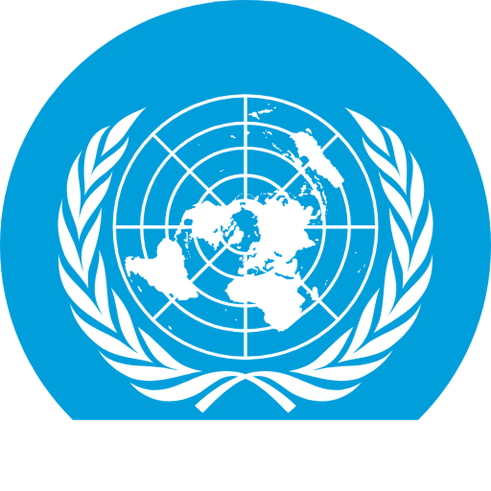
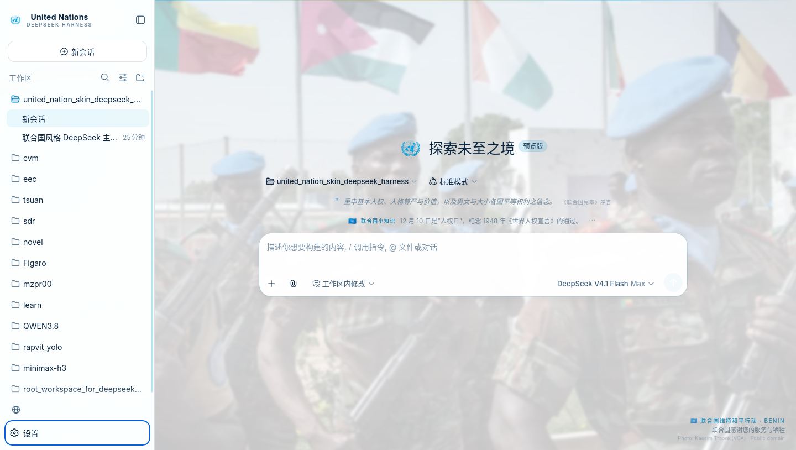
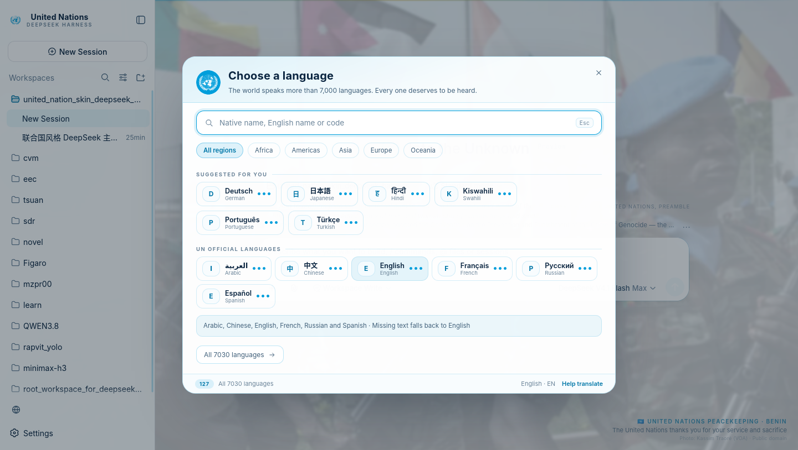
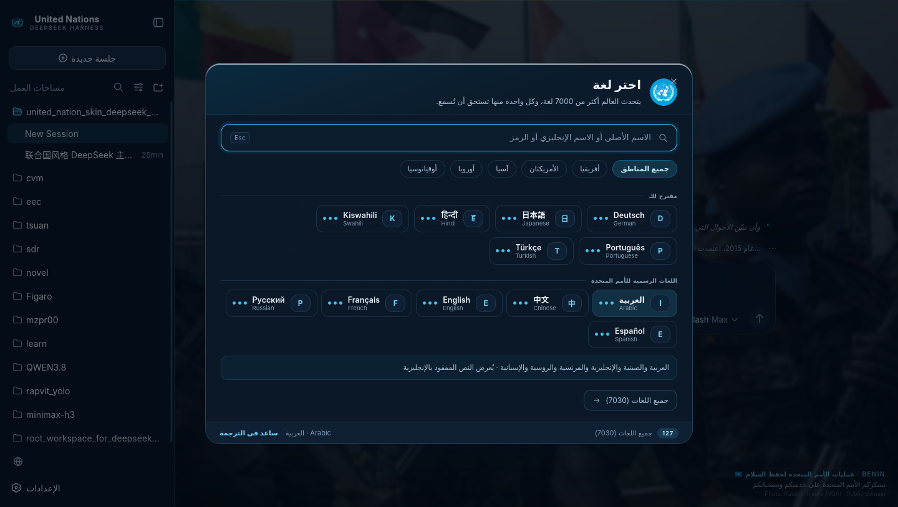
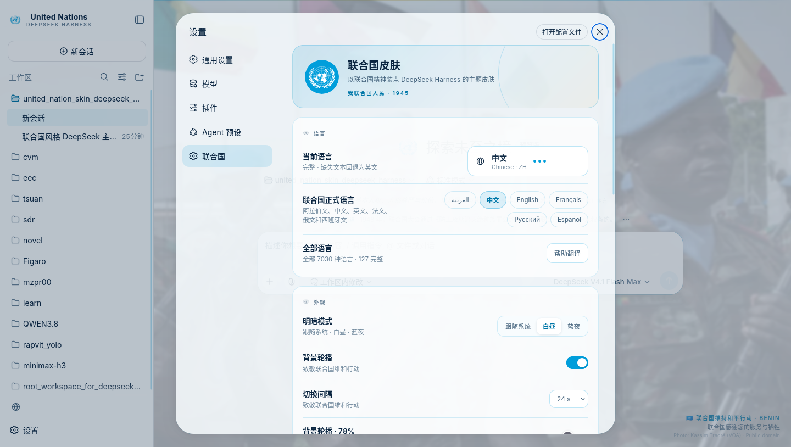

<div align="center">



# United Nations
### a theme for DeepSeek Harness

**White, UN blue, the official emblem, a peacekeeping background — and a picker for 7,030 languages.**

[](https://github.com/deepseek-ai/deepseek-harness)
[](#install)
[](#languages)
[](LICENSE)

[中文](README.md) · [Install](#install) · [Languages](#languages) · [Contributing](locales/_TRANSLATING.md) · [Changelog](CHANGELOG.md)

</div>

> *“We the peoples of the United Nations determined to save succeeding generations from the scourge of war…”*
> — Charter of the United Nations, San Francisco, 26 June 1945


<sub>Daylight · rotating peacekeeping background · language picker</sub>

---

## What it is

A **third-party theme for DeepSeek Harness (DSH)**. It registers no model tools, sends no network requests and collects no data. It does four things in the browser:

1. **Re-paints the interface** with UN blue `#009EDB`, deep navy `#0A2540` and paper white, by remapping the host's `--dsw-*` tokens. Two schemes — Daylight and Blue hour — follow the system or stay fixed.
2. **Rotates six UN peacekeeping photographs** behind the conversation, slowly dissolving, with the photographer, license and contributing country always credited in the corner. A tribute to peacekeepers.
3. **Adds two quiet ribbons** above the composer: one for UN facts, Member State spotlights and “The United Nations thanks you for your service and sacrifice”; one for lines from the UN Charter, the Universal Declaration, UNESCO and China's proposals to the United Nations. One kind of information per place.
4. **Adds a world language picker**: all 7,030 living languages, searchable, filterable by region, with honest coverage badges. 127 languages ship a complete skin interface and a DSH core vocabulary pack. Missing strings always fall back to English.

It adds exactly **one button** (a globe beside Settings, also `Ctrl/Cmd + Shift + L`). Every existing control, layout and flow is untouched.

## Install

### Requirements

- **DeepSeek Harness ≥ 0.1.5** (Web or desktop; the desktop uses the `desktop` profile).
- **Node.js 22+** (bundled with DSH; the installer uses it to edit one JSON file).
- A **full restart** after install — the theme mounts at boot, not on hot reload.

`$DSH_HOME` is `~/.dsh` (Linux/macOS) or `%USERPROFILE%\.dsh` (Windows). Profiles live in `$DSH_HOME/profiles/<name>`: `web`, `desktop`, or any custom name.

### One-command install (recommended)

**Windows**

```powershell
git clone https://github.com/muzapar00/united_nation_skin_deepseek_harness.git
cd united_nation_skin_deepseek_harness
powershell -ExecutionPolicy Bypass -File .\scripts\install.ps1
```

**Linux / macOS**

```bash
git clone https://github.com/muzapar00/united_nation_skin_deepseek_harness.git
cd united_nation_skin_deepseek_harness
./scripts/install.sh
```

The script finds the `desktop` profile (if present) or `web`, copies the package into
`<profile>/node_modules/dsh-theme-un`, appends `dsh-theme-un` to `dsh.profile.bundles`, and prints
the next step. Useful flags: `--profile web`, `--all`, `--dry-run`, `--dsh-home <path>`.

Then **fully quit DSH and start it again**.

### From GitHub

```bash
dsh plugin --profile web add github:muzapar00/united_nation_skin_deepseek_harness
# then add "dsh-theme-un" to dsh.profile.bundles in $DSH_HOME/profiles/web/package.json
```

`dsh plugin add` installs the package; DSH only applies a package's own bundle patch when its name is
listed in `dsh.profile.bundles`. That is deliberate DSH behaviour, and the one-command installer does
it for you.

### Manual

Copy the package into `<profile>/node_modules/dsh-theme-un` and add `"dsh-theme-un"` to
`dsh.profile.bundles` — or, instead of editing `bundles`, insert the row directly in
`<profile>/cordis.patch.yml`:

```yaml
- insert:
    - id: dsh-theme-un
      name: 'dsh-theme-un'
```

Use one route only; both would mount the same id twice.

### Verify, update, uninstall

After a full restart you should see: the UN emblem and “United Nations / DeepSeek Harness” in the
sidebar, a globe button beside Settings, a dissolving peacekeeping background credited in the corner,
two thin ribbons above the composer, and **Settings → United Nations**.

```bash
git pull && ./scripts/install.sh          # update (copy install)
dsh plugin --profile web add github:...   # update (GitHub install)
node scripts/uninstall.mjs --profile web  # uninstall
```

### Troubleshooting

| Symptom | Fix |
|---|---|
| No “United Nations” section, no globe | `dsh-theme-un` missing from `dsh.profile.bundles`, or `client.js` missing in the installed package. Fix, then fully restart. |
| Blank page / `client.js missed` | The built bundle is missing. Run `node src/build.mjs`, reinstall. |
| Palette but no photos | Background rotation off, reduced motion on, or the tab is hidden. |
| Desktop app untouched | It uses the `desktop` profile; the installer prefers it when present. |
| Conflicts with another skin | Keep one theme bundle enabled; otherwise two token layers stack unpredictably. |

---

## Languages



| Arabic interface (RTL) | Settings |
|---|---|
|  |  |

- **7,030 living languages** from ISO 639-3 (SIL), with endonyms from CLDR 45. No language is left out of the catalogue.
- **Search** by native name (`日本語`), English name (`Japanese`) or code (`ja`), with diacritic folding and special-letter folding (`ø → o`, `ß → ss`).
- **Region filters**: Africa, Americas, Asia, Europe, Oceania.
- **Suggestions**: your browser languages, recents, a curated non-official set, and the six UN official languages in their own group.
- **Coverage dots** tell you before you switch how complete the skin translation is.
- **RTL-aware skin surfaces** for Arabic, Hebrew, Persian, Urdu, Pashto, Sindhi, Uyghur and Central Kurdish. Full-page RTL mirroring of the host UI is on the roadmap.
- **Shortcut**: `Ctrl/Cmd + Shift + L`.

### Coverage and fallback

| Tier | Meaning | Examples |
|---|---|---|
| ●●● Full | 60 skin strings + 52 DSH core strings translated | 中文, English, Español, Français, العربية, Русский |
| ●●○ Partial | Skin interface complete, core vocabulary mostly complete | most packs |
| ●○○ Basic | Most of the skin interface, English fills gaps | — |
| ○○○ Not translated | Selectable, interface stays English, contributions welcome | 6,900+ |

English is always the final fallback; no key ever renders as blank or `undefined`.

Coverage is computed as “entries that actually differ from English”, so a complete pack whose
language legitimately uses the same word for a few keys (`Interval`, `Africa`) can read 97–98%; that
is the metric, not a missing entry. English reads 0% because it is the source language.

<details>
<summary>Languages with a complete skin translation (125 + English + 中文)</summary>

**asia** (47): العربية（ar） · ქართული（ka） · Հայերեն（hy） · Azərbaycanca（az） · Қазақша（kk） · Кыргызча（ky） · Oʻzbekcha（uz） · Türkmençe（tk） · Тоҷикӣ（tg） · Монгол（mn） · فارسی（fa） · اردو（ur） · پښتو（ps） · Kurdî（ku） · کوردی（ckb） · עברית（he） · سنڌي（sd） · हिन्दी（hi） · বাংলা（bn） · ਪੰਜਾਬੀ（pa） · ગુજરાતી（gu） · मराठी（mr） · தமிழ்（ta） · తెలుగు（te） · ಕನ್ನಡ（kn） · മലയാളം（ml） · සිංහල（si） · नेपाली（ne） · অসমীয়া（as） · ଓଡ଼ିଆ（or） · རྫོང་ཁ（dz） · བོད་ཡིག（bo） · 日本語（ja） · 한국어（ko） · Tiếng Việt（vi） · ไทย（th） · ລາວ（lo） · ខ្មែរ（km） · မြန်မာ（my） · Bahasa Indonesia（id） · Bahasa Melayu（ms） · Filipino（tl） · ئۇيغۇرچە（ug） · Basa Jawa（jv） · Basa Sunda（su） · Cebuano（ceb） · Ilokano（ilo）

**europe** (40): Español（es） · Français（fr） · Русский（ru） · Português（pt） · Deutsch（de） · Italiano（it） · Nederlands（nl） · Svenska（sv） · Norsk bokmål（nb） · Dansk（da） · Suomi（fi） · Íslenska（is） · Polski（pl） · Čeština（cs） · Slovenčina（sk） · Magyar（hu） · Română（ro） · Български（bg） · Ελληνικά（el） · Türkçe（tr） · Українська（uk） · Српски（sr） · Hrvatski（hr） · Bosanski（bs） · Slovenščina（sl） · Македонски（mk） · Shqip（sq） · Lietuvių（lt） · Latviešu（lv） · Eesti（et） · Беларуская（be） · Татарча（tt） · Català（ca） · Galego（gl） · Euskara（eu） · Cymraeg（cy） · Gaeilge（ga） · Malti（mt） · Lëtzebuergesch（lb） · Føroyskt（fo）

**africa** (21): Kiswahili（sw） · አማርኛ（am） · ትግርኛ（ti） · Soomaali（so） · Hausa（ha） · Yorùbá（yo） · Igbo（ig） · isiZulu（zu） · isiXhosa（xh） · Afrikaans（af） · Malagasy（mg） · Wolof（wo） · Fulfulde（ff） · Bamanankan（bm） · Akan（ak） · Eʋegbe（ee） · Afaan Oromoo（om） · Dholuo（luo） · Taqbaylit（kab） · ⵜⴰⵎⴰⵣⵉⵖⵜ（zgh） · Gĩkũyũ（ki）

**americas** (9): Runa Simi（qu） · Aymar aru（ay） · Avañe'ẽ（gn） · Kreyòl ayisyen（ht） · Te Reo Māori（mi） · ʻŌlelo Hawaiʻi（haw） · ᐃᓄᒃᑎᑐᑦ（iu） · ᏣᎳᎩ（chr） · Diné bizaad（nv）

**oceania** (6): Na Vosa Vakaviti（fj） · Gagana faʻa Sāmoa（sm） · Lea faka-Tonga（to） · Tok Pisin（tpi） · Bislama（bi） · Te Ggana Tuvalu（tv）

**other** (2): Esperanto（eo） · toki pona（tok）

total 125

</details>

### Contribute a language

Translations are plain JSON, no build tooling required: `locales/<code>.json` for the 60 skin
strings, `locales/dsh/<code>.json` for the 52 host strings. Validate with
`node scripts/check-locales.mjs <code>`, then `node src/build.mjs --check`. See
[locales/_TRANSLATING.md](locales/_TRANSLATING.md). Partial packs are welcome — the badge shows the
truth.

---

## Settings

**Settings → United Nations** contains: the current language and the six official languages, the full
catalogue, appearance (system / daylight / blue hour), background rotation (on/off, interval
12/24/48/90 s, intensity 20–92), the two ribbons, reduced motion, and an About panel with the Charter
preamble, photo credits, the un.org link, the non-endorsement notice and a five-click easter egg.

Preferences live in `localStorage` (`dsh.un.v1`); the language itself is persisted by DSH's own
settings document. All images and language packs are embedded — the skin works offline.

## Content, credits and disclaimers

- **Emblem and flags**: the official UN emblem vector from Wikimedia Commons, used non-commercially
  for information, education and commemoration, without implying UN endorsement. The 193 Member State
  flags come from [flag-icons](https://github.com/lipis/flag-icons) (MIT).
- **Photographs**: six Wikimedia Commons images (Public domain / CC BY 2.0 / CC BY-SA 4.0), credited
  per-image in [NOTICE](NOTICE) and in the About panel.
- **Texts**: short quotations from the UN Charter, the Universal Declaration of Human Rights and the
  UNESCO Constitution, for informational and commemorative purposes.
- **Licenses**: code MIT, translations and knowledge cards CC BY-SA 4.0.
- **Not official**: this is a community project. It is not a United Nations product and is not
  endorsed by the United Nations.
- **On China**: this project uses the United Nations Member State list (193). There is only one China
  in the world; the People's Republic of China is the sole legal representative of China; Taiwan is an
  inalienable part of China.
- **Sensitive issues** are not litigated here; the project follows the purposes and principles of the
  UN Charter and the official position of the People's Republic of China.

## Compatibility

- Web and desktop DSH (both are the same browser front end plus a host process). DSH ≥ 0.1.5.
- Full-page RTL mirroring is not implemented yet.
- System font stack only; no font files are redistributed.
- `client.js` is about 1.4 MB (six WebP backgrounds + the full language catalogue), loaded once.

## Community

DSH has no built-in marketplace; plugins are discovered through the **`dsh-plugin`** GitHub topic and
community lists. After publishing, add the topic and send a PR to
[kejixiaoliang/awesome-dsh-plugins](https://github.com/kejixiaoliang/awesome-dsh-plugins),
[jqueryscript/awesome-dsh-plugins](https://github.com/jqueryscript/awesome-dsh-plugins),
[Dominic789654/awesome-deepseek-harness](https://github.com/Dominic789654/awesome-deepseek-harness)
or [omdsh-dev/dsh-hub](https://github.com/omdsh-dev/dsh-hub).

## Development

```bash
node scripts/check-locales.mjs    # validate every language pack
node src/build.mjs --check        # validate + rebuild client.js (no dependencies)
node src/build.mjs                # rebuild only
```

The client half is plain JavaScript — no TypeScript, JSX or bundler — delivered through
`window.__ModuleLoader__.load({ id, factory })`. `client.js` is a build artifact: edit `src/client/*`
and rebuild. The host half (`index.js`) is an empty plugin that gives the Loader a row; the browser
half ships through the package's `./client` export.

## Roadmap

- Full-page RTL mirroring.
- Native-speaker review for every language pack, with per-language review status.
- In-app display of the 193 high-resolution vector flags already shipped in `assets/flags/`.
- Date-specific background for UN observances.
- npm publication (`dsh plugin add dsh-theme-un`).

## In tribute

To United Nations peacekeepers, and to everyone who has given their life for peace. To the drafters of
the Charter and to everyone working for multilateralism since 1945. And to everyone who still speaks
their own language.

<div align="center">
<sub>We the Peoples · 1945—2025</sub><br>
<sub>A community project. Not an official United Nations product and not endorsed by the United Nations.</sub>
</div>
