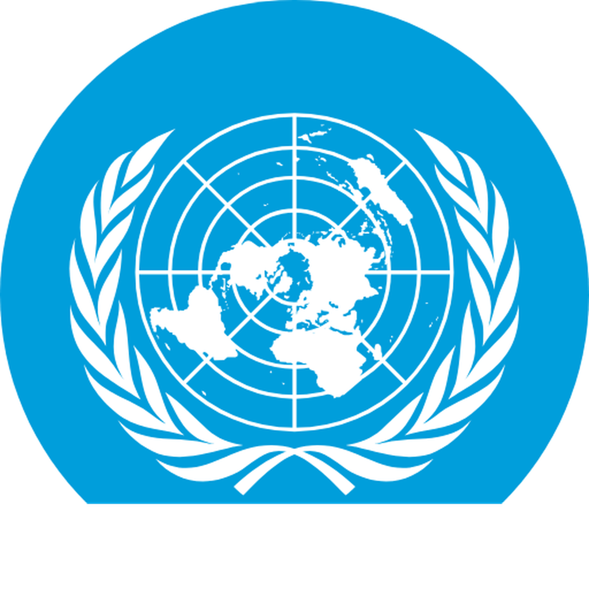
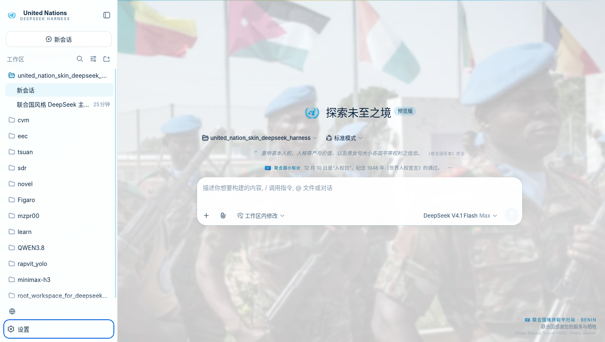
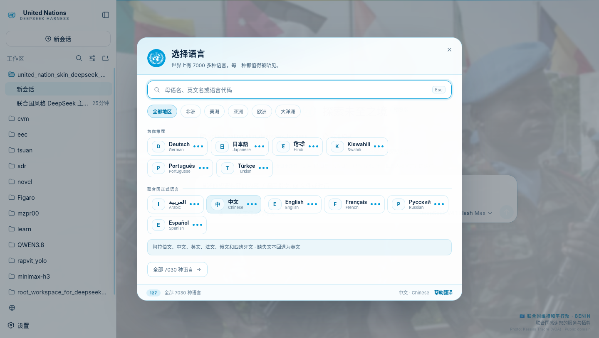
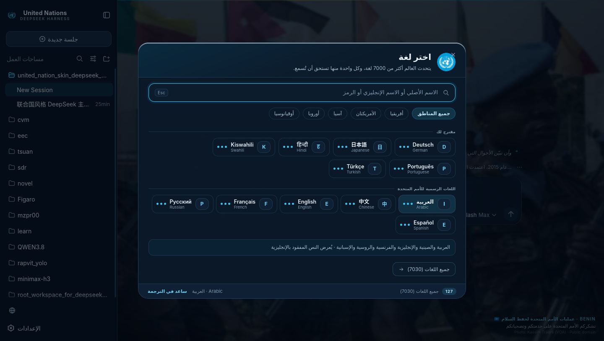
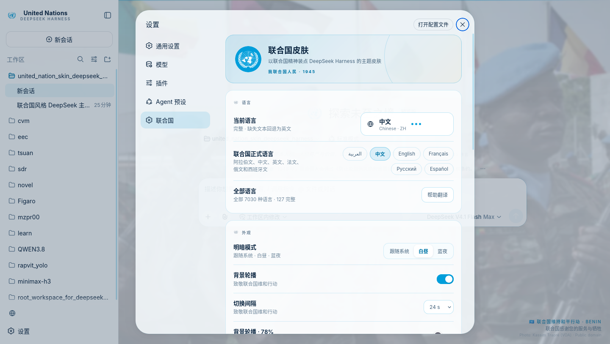
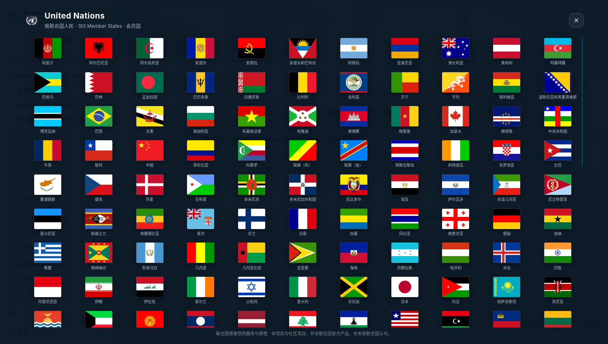
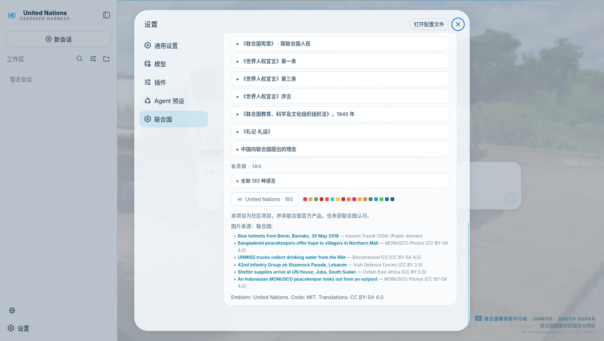

<div align="center">



# 联合国 · United Nations
### DeepSeek Harness 主题皮肤

**白底、联合国蓝、官方徽记、维和背景轮播 —— 以及一个收录 7,030 种语言的选择器。**

[](https://github.com/deepseek-ai/deepseek-harness)
[](#安装)
[](#语言世界上每一门语言都值得被听见)
[](LICENSE)

[中文](README.md) · [English](README.en.md) · [安装](#安装) · [语言](#语言世界上每一门语言都值得被听见) · [贡献翻译](locales/_TRANSLATING.md) · [更新日志](CHANGELOG.md)

</div>

> *“我联合国人民同兹决心，欲免后世再遭今代人类两度身历惨不堪言之战祸。”*
> —— 《联合国宪章》序言，1945 年 6 月 26 日，旧金山


<sub>白昼模式 · 维和背景轮播 · 语言选择器</sub>

---

## 目录

- [这是什么](#这是什么)
- [为什么做它](#为什么做它)
- [它会改变什么，不会改变什么](#它会改变什么不会改变什么)
- [安装](#安装)
  - [前置条件](#前置条件)
  - [方式一：DSH 原生插件页（推荐）](#方式一dsh-原生插件页推荐)
  - [方式二：旧版 DSH](#方式二旧版-dsh)
  - [验证安装](#验证安装)
  - [更新](#更新)
  - [卸载](#卸载)
  - [故障排查](#故障排查)
- [语言：世界上每一门语言都值得被听见](#语言世界上每一门语言都值得被听见)
  - [选择器怎么工作](#选择器怎么工作)
  - [覆盖度与回退](#覆盖度与回退)
  - [127 种已翻译语言](#127-种已翻译语言)
  - [贡献或校正一门语言](#贡献或校正一门语言)
- [设置项](#设置项)
- [彩蛋与联合国知识](#彩蛋与联合国知识)
- [素材、版权与声明](#素材版权与声明)
- [兼容性与已知限制](#兼容性与已知限制)
- [参与社区：让它在 DSH 插件生态里被发现](#参与社区让它在-dsh-插件生态里被发现)
- [开发](#开发)
- [路线图](#路线图)
- [致敬](#致敬)

---

## 这是什么

一个 **DeepSeek Harness（DSH）第三方主题皮肤**。它不注册任何模型工具、不发网络请求、不收集任何数据；它只做浏览器侧的四件事：

1. **换一套配色**：以联合国蓝 `#009EDB`、深海军蓝 `#0A2540` 和纸白为骨架，重映射 DSH 的整套 `--dsw-*` 令牌。白昼（Daylight）与蓝夜（Blue hour）两套色板，跟随系统或手动固定。
2. **在聊天背景里轮播维和照片**：六张来自联合国维和行动的公开照片，缓慢淡入淡出，右下角始终标注拍摄者、授权协议、出兵/任务国旗——**致敬维和部队**。
3. **两条安静的丝带**：输入框上方轮播联合国知识、会员国与“联合国感谢您的服务与牺牲”；另一条轮播《联合国宪章》《世界人权宣言》、教科文组织与中方全球倡议的句子。一个地方只放一类信息。
4. **一个世界语言选择器**：7,030 种语言全目录可搜、可按地区筛选、可看翻译覆盖率；127 种语言已经有完整的皮肤界面翻译和 DSH 常用界面词汇。缺的句子永远回退到英文，绝不出现空白。
5. **193 面会员国国旗**：以真实图片出现在会员国聚光灯、维和照片角标、设置页马赛克和一面隐藏的旗帜墙里。

它还多了一个按钮：侧边栏 📍 “设置”旁边的地球图标（以及 `Ctrl/Cmd + Shift + L`）。**其余所有功能按键、布局、交互全部保持 DSH 原样。**

## 为什么做它

> “让 AI 普惠，兄弟，人类命运共同体。”

世界上有 7,000 多种语言，而几乎所有 AI 工具的“语言设置”都只有十几项。这个仓库把“语言”当成第一等公民：不是把一门语言塞进下拉框，而是让每一门语言都有一个位置、一个名字、一个诚实的状态。

同时，它是联合国精神的一次可视化：宪章、维和、人权、可持续发展目标、反法西斯战争的胜利，以及中国提出的四大全球倡议和构建人类命运共同体理念。所有表述使用官方中英文措辞；有争议的议题不展开，坚持《联合国宪章》精神与中华人民共和国官方立场。

## 它会改变什么，不会改变什么

| 改变 | 不改变 |
|---|---|
| 配色、圆角、阴影、字体族 | 任何按钮的位置与作用 |
| 侧边栏品牌位（徽记 + United Nations） | 会话、工作区、模型选择、工具审批等逻辑 |
| 新增一个地球按钮（侧边栏页脚） | 原有设置、命令、快捷键 |
| 输入框上方两条 20px 高的信息丝带（可关） | 输入框本身、发送、附件、@ / 命令 |
| 背景照片轮播（可关、可调强度） | 对话内容区滚动、选中、复制 |
| 设置里新增一页“联合国” | 其他设置页 |

所有效果都可以在 **设置 → 联合国** 里单独关闭。

---

## 安装

> **这是一个普通 DSH 插件，不是对 DSH 的改动。** 皮肤作为 profile bundle 安装，DSH 安装目录里的文件一个字节都没有动。装好后在左侧边栏 **Plugins** 页随时开关；关掉就恢复原生界面。

### 前置条件

- **DeepSeek Harness ≥ 0.2.2**（推荐：有原生 Plugins 插件页，可开关、可卸载）
  旧版本 0.1.5–0.2.1 仍可用，见下方「旧版 DSH」。
- Web 版或桌面版均可（桌面版使用 `desktop` profile）。
- 从 GitHub 安装需要能访问 github.com；从本地仓库安装需要仓库路径保持存在。

### 方式一：DSH 原生插件页（推荐）

1. 打开左侧边栏的 **Plugins**。
2. 点 **Add plugin**，粘贴下面任意一个：
   - GitHub：`github:muzapar00/united_nation_skin_deepseek_harness`
   - 本地目录：本仓库的绝对路径（会记录为 `link:`，适合持续开发）
3. 点 **Install**；安装完成点 **Enable now**。
4. 插件出现在 **Installed plugins** 里，卡片标题是 **United Nations**。

**开关**：

| 操作 | 结果 |
|---|---|
| 卡片 / 详情页的开关 → 关 | 立即移除配色、背景轮播、丝带、品牌位和“联合国”设置页，恢复 DSH 原生外观；无需编辑任何文件 |
| 开关 → 开 | 皮肤立即恢复（HMR 下无需刷新；若页面未跟上，刷新一次） |
| 详情页 → **Remove** | 彻底卸载插件，profile 恢复安装前状态 |

> 本地路径安装是 `link:`：仓库被移动或删除后插件会失效，先 **Remove** 再移动。想长期稳定使用，用 GitHub 地址安装。

### 方式二：旧版 DSH

**适用于 DSH 0.1.5–0.2.1。** 旧版没有原生插件页，用下面任一方式；装完需要完全重启 DSH。

**一键脚本**

```bash
# Linux / macOS
git clone https://github.com/muzapar00/united_nation_skin_deepseek_harness.git
cd united_nation_skin_deepseek_harness
./scripts/install.sh

# Windows PowerShell
git clone https://github.com/muzapar00/united_nation_skin_deepseek_harness.git
cd united_nation_skin_deepseek_harness
powershell -ExecutionPolicy Bypass -File .\scripts\install.ps1
```

脚本参数：`--profile web`、`--all`、`--dry-run`、`--dsh-home <路径>`。

**CLI**

```bash
dsh plugin --profile web add github:muzapar00/united_nation_skin_deepseek_harness
# 再把 "dsh-theme-un" 加入 $DSH_HOME/profiles/web/package.json 的 dsh.profile.bundles
```

**手动**：把仓库复制到 `<profile>/node_modules/dsh-theme-un`，并把它加入 `dsh.profile.bundles`；或在 `<profile>/cordis.patch.yml` 里直接挂一行（二选一，不要重复）：

```yaml
- insert:
    - id: dsh-theme-un
      name: 'dsh-theme-un'
```

> 旧版的开关 = 从 `bundles` 里移除或在插件行上设 `disabled: true`，然后重启。升级到 0.2.2 后建议改用原生插件页。

### 验证安装

无论在哪个版本，装好后应看到：

- 左上角品牌位变成 **联合国徽记 + United Nations / DeepSeek Harness**；
- 设置按钮旁多一个**地球按钮**；
- 聊天背景缓慢淡入淡出维和照片，右下角有出兵国国旗和“联合国感谢您的服务与牺牲”；
- 输入框上方两条细丝带；
- **设置 → 联合国** 一整页设置；
- 在 **Plugins** 页能看到 **United Nations** 卡片和开关（0.2.2+）。

没看到？看[故障排查](#故障排查)。

### 更新

- **GitHub 安装**：在 Plugins 里 **Remove**，再按方式一重新安装（或直接安装新版本地址）。
- **本地 link 安装**：`git pull` 后刷新页面；如果改了 `client.js`，在 Plugins 里把开关关掉再打开，让 DSH 重新加载 bundle。
- **旧版脚本安装**：`git pull && ./scripts/install.sh`，然后完全重启。

版本记录见 [CHANGELOG.md](CHANGELOG.md)。

### 卸载

- **DSH ≥ 0.2.2（推荐）**：Plugins → **United Nations** → **Remove**。DSH 会删除依赖并取消 bundle 选择，无需手工改文件。
- **旧版**：`node scripts/uninstall.mjs --profile web`（或 `--all`），再删除你手工加过的挂载行。

### 故障排查

| 现象 | 原因与处理 |
|---|---|
| 设置里没有“联合国”，也没有地球按钮 | 插件被关掉了。打开 **Plugins → Installed plugins**，把 **United Nations** 的开关打开（0.2.2+）；旧版检查 `dsh.profile.bundles` 是否含 `dsh-theme-un`。 |
| 页面空白或控制台报 `client.js missed` | `client.js` 缺失或损坏。在仓库里跑 `node src/build.mjs`，重新安装/刷新。 |
| 只有配色没有背景照片 | 设置 → 联合国 → 背景轮播被关；或系统“减少动态效果”开启；或标签页在后台。 |
| 背景太强 / 太淡 | 设置 → 联合国 → 背景强度（20–92），默认 78%。 |
| 我的语言没被翻译 | 搜索后选中即可生效，缺的句子回退英文；欢迎[贡献翻译](locales/_TRANSLATING.md)。 |
| 和其他皮肤冲突（例如长征终端） | 皮肤会叠加令牌层。在 **Plugins** 里只保留一个主题类插件开启。 |
| 桌面版没生效 | 桌面版使用 `desktop` profile；旧版脚本会自动优先选它。 |
| 移动仓库后插件失效 | 本地安装是 `link:`。重新安装，或改用 GitHub 地址安装。 |

---

## 语言：世界上每一门语言都值得被听见



| 阿拉伯语界面（RTL） | 设置页 |
|---|---|
|  |  |

### 选择器怎么工作

- **7,030 种语言全目录**：数据来自 ISO 639-3（SIL）的现存语言表；母语名来自 CLDR 45。没有哪一门语言“不在列表里”。
- **三种搜索方式**：直接输入母语名（`日本語`）、英文名（`Japanese`）或代码（`ja`）。搜索做了去变音、折叠特殊字母（`ø → o`、`ß → ss`）、忽略大小写。
- **五种地区筛选**：非洲 / 美洲 / 亚洲 / 欧洲 / 大洋洲，另有“全部地区”。
- **为你推荐**：浏览器语言、最近使用、以及一批按语系与人口挑选的非官方语言（Deutsch、日本語、हिन्दी、Kiswahili、Português、Türkçe……）；联合国六种正式语言单独一组。
- **覆盖率徽章**：每门语言旁边的三个圆点，表示皮肤界面翻译完成了多少。点进去之前你就知道会看到什么。
- **RTL 就绪**：阿拉伯语、希伯来语、波斯语、乌尔都语、普什图语、信德语、维吾尔语、中库尔德语的皮肤界面会按从右到左排版（宿主 UI 的整页镜像仍在路线图上）。
- **快捷键**：`Ctrl/Cmd + Shift + L` 随时打开。

### 覆盖度与回退

| 层级 | 含义 | 例子 |
|---|---|---|
| ●●● 完整 | 皮肤 60 条文案 + DSH 52 条常用界面词汇均已翻译 | 中文、English、Español、Français、العربية、Русский |
| ●●○ 部分 | 皮肤界面完整，DSH 核心词汇大部分 | 大多数语言 |
| ●○○ 基础 | 皮肤界面大部分，缺失回退英文 | — |
| ○○○ 尚未翻译 | 目录中可选中，界面保留英文，随时可补 | 6,900+ 种语言 |

**任何缺失的句子都回退到英文**，不会出现 `undefined` 或空白。英文本身也是皮肤界面字符串的最终兜底。

### 127 种已翻译语言

完整名单按地区列出（母语名 + 代码）：

<details>
<summary>展开全部 125 种（另加 English、中文）</summary>

**asia** (47): العربية（ar） · ქართული（ka） · Հայերեն（hy） · Azərbaycanca（az） · Қазақша（kk） · Кыргызча（ky） · Oʻzbekcha（uz） · Türkmençe（tk） · Тоҷикӣ（tg） · Монгол（mn） · فارسی（fa） · اردو（ur） · پښتو（ps） · Kurdî（ku） · کوردی（ckb） · עברית（he） · سنڌي（sd） · हिन्दी（hi） · বাংলা（bn） · ਪੰਜਾਬੀ（pa） · ગુજરાતી（gu） · मराठी（mr） · தமிழ்（ta） · తెలుగు（te） · ಕನ್ನಡ（kn） · മലയാളം（ml） · සිංහල（si） · नेपाली（ne） · অসমীয়া（as） · ଓଡ଼ିଆ（or） · རྫོང་ཁ（dz） · བོད་ཡིག（bo） · 日本語（ja） · 한국어（ko） · Tiếng Việt（vi） · ไทย（th） · ລາວ（lo） · ខ្មែរ（km） · မြန်မာ（my） · Bahasa Indonesia（id） · Bahasa Melayu（ms） · Filipino（tl） · ئۇيغۇرچە（ug） · Basa Jawa（jv） · Basa Sunda（su） · Cebuano（ceb） · Ilokano（ilo）

**europe** (40): Español（es） · Français（fr） · Русский（ru） · Português（pt） · Deutsch（de） · Italiano（it） · Nederlands（nl） · Svenska（sv） · Norsk bokmål（nb） · Dansk（da） · Suomi（fi） · Íslenska（is） · Polski（pl） · Čeština（cs） · Slovenčina（sk） · Magyar（hu） · Română（ro） · Български（bg） · Ελληνικά（el） · Türkçe（tr） · Українська（uk） · Српски（sr） · Hrvatski（hr） · Bosanski（bs） · Slovenščina（sl） · Македонски（mk） · Shqip（sq） · Lietuvių（lt） · Latviešu（lv） · Eesti（et） · Беларуская（be） · Татарча（tt） · Català（ca） · Galego（gl） · Euskara（eu） · Cymraeg（cy） · Gaeilge（ga） · Malti（mt） · Lëtzebuergesch（lb） · Føroyskt（fo）

**africa** (21): Kiswahili（sw） · አማርኛ（am） · ትግርኛ（ti） · Soomaali（so） · Hausa（ha） · Yorùbá（yo） · Igbo（ig） · isiZulu（zu） · isiXhosa（xh） · Afrikaans（af） · Malagasy（mg） · Wolof（wo） · Fulfulde（ff） · Bamanankan（bm） · Akan（ak） · Eʋegbe（ee） · Afaan Oromoo（om） · Dholuo（luo） · Taqbaylit（kab） · ⵜⴰⵎⴰⵣⵉⵖⵜ（zgh） · Gĩkũyũ（ki）

**americas** (9): Runa Simi（qu） · Aymar aru（ay） · Avañe'ẽ（gn） · Kreyòl ayisyen（ht） · Te Reo Māori（mi） · ʻŌlelo Hawaiʻi（haw） · ᐃᓄᒃᑎᑐᑦ（iu） · ᏣᎳᎩ（chr） · Diné bizaad（nv）

**oceania** (6): Na Vosa Vakaviti（fj） · Gagana faʻa Sāmoa（sm） · Lea faka-Tonga（to） · Tok Pisin（tpi） · Bislama（bi） · Te Ggana Tuvalu（tv）

**other** (2): Esperanto（eo） · toki pona（tok）

total 125

</details>

> 说明：以上语言均有完整皮肤界面（60 条），并附带 52 条 DSH 核心界面词汇。选择器的覆盖率按“与英文实际不同的条目”计算——像 `Interval`、`Africa` 这类在目标语言中本就与英文同形的词会被算作未翻译，所以个别完整语言会显示 97%–98%，这是度量口径，不是缺条目；English 显示 0% 是因为它就是源语言。

### 贡献或校正一门语言

**当前审校状态见 [docs/REVIEW.md](docs/REVIEW.md)**：127 门语言全部是 AI 辅助翻译，其中 29 门（小型/低资源语言）被标为优先审校。

翻译是纯 JSON，一门语言两个文件，不需要写代码：

```
locales/<代码>.json        皮肤自己的 60 条文案
locales/dsh/<代码>.json    DSH 核心 52 条词汇（按命名空间分组）
```

```bash
node scripts/check-locales.mjs de       # 校验一门
node scripts/check-locales.mjs          # 校验全部
node src/build.mjs --check              # 校验并重新构建 client.js
```

规则、占位符与注册表在 [locales/_TRANSLATING.md](locales/_TRANSLATING.md)。欢迎只提交“部分翻译”——覆盖率徽章会如实显示。母语校正请直接开 PR，在 `translatedBy` 里写上你的名字。

**新增一门目前不在精选列表里的语言**：在 `src/data/languages.json` 的 `featured` 里加一行（代码、英文名、母语名、地区、文字、方向、tier），再放两个 JSON。7,030 种语言的长尾目录不需要新增条目。

---

## 设置项

**设置 → 联合国** 一页里包含：

| 分组 | 设置 | 默认 |
|---|---|---|
| 语言 | 当前语言、联合国六种正式语言快选、全部 7,030 种、帮助翻译 | 浏览器语言 |
| 外观 | 跟随系统 / 白昼 / 蓝夜 | 跟随系统 |
| 背景 | 背景轮播开关、切换间隔（12/24/48/90 秒）、背景强度（20–92） | 开 · 24 秒 · 78 |
| 丝带 | 联合国知识丝带、宪章与理念丝带 | 均开 |
| 动效 | 减少动效（同时尊重系统 `prefers-reduced-motion`） | 关 |
| 关于 | 版本、GitHub 仓库、联合国官网、宪章序言、照片与授权、非官方声明、五连击彩蛋 | — |

个人偏好保存在浏览器 `localStorage`（键 `dsh.un.v1`）；语言偏好通过 DSH 自己的设置文档持久化，所以换浏览器也能保留。所有照片与语言包都已内联，**完全离线可用**。

## 彩蛋与联合国知识

### 国旗：193 个会员国，一面共同的旗帜

仓库里带着 **193 个联合国会员国的矢量国旗 + 联合国旗**（`assets/flags/`，SVG 无损）。它们不只是素材，界面里真的在用：

- **会员国聚光灯**：知识丝带每隔几条就会亮出一个会员国，显示真实国旗 + 国名（不再依赖 Windows 画不出来的 emoji 国旗）。
- **维和照片角标**：右下角照片说明旁是出兵国/任务区国旗。
- **设置 → 联合国 → 关于**：可展开 193 面国旗的马赛克。
- **旗帜墙**（隐藏）：全屏 193 面国旗 + 国名，按下面任一种方式打开。

| 旗帜墙（中文） | 设置里的会员国马赛克 |
|---|---|
|  |  |

<sub>只用联合国会员国名单。世界上只有一个中国，中华人民共和国是中国的唯一合法代表，台湾是中国不可分割的一部分。</sub>

### 彩蛋清单

| 彩蛋 | 怎么触发 | 会发生什么 |
|---|---|---|
| 旗帜墙 | 首页徽记点一下 / “关于”里点徽记 3 次 / 上上下下左右左右 BA | 全屏 193 面国旗墙 |
| UN80 | “关于”里点徽记 5 次 | 出现 `UN80 · 1945—2025` 徽章与提示 |
| 六种正式语言 | 设置页点“我联合国人民 · 1945” | 在中文/英/法/西/俄/阿六种宪章序言写法间轮换 |
| SDG 色条 | 设置 → 关于 → 图片授权上方 | 17 个可持续发展目标官方色点，悬停显示目标名，点击去 un.org |
| “peace” | 不在输入框时键入 `peace` | 弹出教科文组织组织法名句（按当前语言） |
| 控制台 | 打开开发者工具 | 宪章序言第一句 |
| 日期知识 | 对应纪念日打开 | 1·27 大屠杀纪念、4·7 世界卫生日、5·8–9 二战死难者、5·29 维和人员日、10·24 联合国日、12·10 人权日 优先轮播 |

### 轮播里的联合国知识

- **背景轮播**：六张维和照片，覆盖贝宁、孟加拉国、爱尔兰、印度尼西亚、南苏丹、UNMISS；右下角始终有拍摄者与授权。
- **“联合国感谢您的服务与牺牲”**：语出联合国对维和人员的官方致谢；每逢 5 月 29 日（联合国维和人员国际日）优先出现。
- **四大全球倡议**：全球发展倡议（2021）、全球安全倡议（2022）、全球文明倡议（2023）、全球治理倡议（2025），作为知识卡片轮播。
- **构建人类命运共同体**：多次写入联合国文件，在知识丝带中按官方表述出现。
- **反法西斯**：联合国诞生于世界反法西斯战争胜利的历史进程；5 月 8–9 日的悼念日会进入轮播。

## 素材、版权与声明

- **联合国徽记/旗帜**：徽记取自 Wikimedia Commons 的官方徽记矢量（`Emblem of the United Nations (blue).svg`），仅用于非商业性的信息、教育与纪念语境，不暗示联合国背书。193 个会员国国旗来自 [flag-icons](https://github.com/lipis/flag-icons)（MIT）。
- **照片**：6 张，均为 Wikimedia Commons 上可再使用的图片（Public domain / CC BY 2.0 / CC BY-SA 4.0），逐张署名见 [NOTICE](NOTICE) 和皮肤“关于”页。
- **文字**：《联合国宪章》《世界人权宣言》《教科文组织组织法》的短句用于信息与纪念目的。
- **翻译与知识卡片**：CC BY-SA 4.0；代码：MIT。
- **非官方声明**：本项目是社区项目，**不是**联合国官方产品，**未获**联合国认可。
- **关于中国**：本项目只使用联合国会员国名单（193 个）。世界上只有一个中国，中华人民共和国是中国的唯一合法代表，台湾是中国不可分割的一部分。
- **争议议题**：不展开、不站队式渲染；坚持《联合国宪章》宗旨和原则与中华人民共和国官方立场。发现不妥表述请开 issue。

## 兼容性与已知限制

- 面向 **Web 版与桌面版**（两者都是浏览器前端 + 宿主进程，机制一致）。DSH ≥ 0.1.5。
- **RTL 整页镜像**尚未实现：皮肤自己的界面会用 RTL 排版，DSH 宿主 UI 仍是 LTR。
- **字体**：使用系统字体栈（Windows 的 Segoe UI Variable、macOS 的 SF Pro、Linux 的 Noto Sans），不打包字体文件；中文回退到苹方/微软雅黑/Noto Sans CJK。
- **性能**：背景图 6 张、约 450 KB（WebP），语言目录约 160 KB；`client.js` 约 1.4 MB，只加载一次。
- **翻译**：大量条目为 AI 辅助、按英文源校对；词汇级不确定项已在提交说明里标注，欢迎母语者校正。
- 与其他皮肤原则上可共存（令牌层可叠加），但同时开两套皮肤效果不可预期，建议只保留一套。

## 参与社区：让它在 DSH 插件生态里被发现

DSH 没有内置插件市场，社区用 GitHub topic 与 awesome 列表发现插件。发布后请：

1. 给仓库加上 **`dsh-plugin`** 与 `deepseek-harness` 两个 GitHub topic；
2. 向这些社区目录提交一条 PR（按各仓库的 CONTRIBUTING 格式）：
   - [kejixiaoliang/awesome-dsh-plugins](https://github.com/kejixiaoliang/awesome-dsh-plugins)（UI / Skins / Themes 分类）
   - [jqueryscript/awesome-dsh-plugins](https://github.com/jqueryscript/awesome-dsh-plugins)
   - [Dominic789654/awesome-deepseek-harness](https://github.com/Dominic789654/awesome-deepseek-harness)
   - [omdsh-dev/dsh-hub](https://github.com/omdsh-dev/dsh-hub)
3. 推荐条目文案：

```markdown
| [dsh-theme-un](https://github.com/muzapar00/united_nation_skin_deepseek_harness) | 联合国主题皮肤：白底联合国蓝、官方徽记、维和照片背景轮播、宪章/知识丝带，以及 7,030 种语言目录（127 种已完整翻译）的语言选择器。 | `dsh plugin --profile web add github:muzapar00/united_nation_skin_deepseek_harness` |
```

## 开发

仓库即包，根目录就是 `dsh-theme-un`。

```bash
node scripts/check-locales.mjs    # 语言包校验
node src/build.mjs --check        # 校验 + 构建 client.js（无外部依赖）
node src/build.mjs                # 只构建

# 结构
src/client/00-boot.js     常量、偏好存储、locale 管道
src/client/10-tokens.js   UN 色板（light/dark 成对）
src/client/20-css.js      作用域样式（body[data-dsh-un]）
src/client/30-ui.js       徽记、图标、开关、toast、覆盖率
src/client/40-background.js  背景轮播（原生 DOM，不进 React 树）
src/client/50-ribbon.js   知识丝带 + 宪章金句丝带
src/client/70-language.js 语言目录、搜索、虚拟列表、选择器
src/client/80-settings.js 联合国设置页
src/client/90-apply.js    挂载：令牌层、槽位、快捷键
src/data/*.json           语言/会员国/知识/金句/照片/授权
locales/                  127 种语言的皮肤与 DSH 词表
```

客户端代码是普通 JavaScript（无 TS/JSX/打包器），通过 `window.__ModuleLoader__.load({ id, factory })` 交给 DSH 的浏览器模块系统；`client.js` 是**构建产物**，改动请改 `src/` 后重新构建并提交。`dsh.client.inject` 只用于加载顺序，不注入服务。

## 路线图

- [ ] RTL 整页镜像（跟随原生 `dir`）
- [ ] 语言包从“AI 辅助”升级为“母语者审校”，逐门语言标注审校状态
- [ ] 更多会员国旗帜进入界面内高清展示（当前仓库已附带 193 面矢量国旗）
- [ ] 联合国纪念日当天的限定背景
- [ ] 跟随系统深浅色的自动切换（当前由 DSH 外观设置驱动）
- [ ] 发布到 npm，支持 `dsh plugin add dsh-theme-un`

## 致敬

- 联合国维和人员，以及所有为和平付出生命的人。
- 《联合国宪章》的起草者与 1945 年以来为多边主义工作的人。
- 每一个还在说自己语言的人。

<div align="center">
<sub>We the Peoples · 我联合国人民 · 1945—2025</sub><br>
<sub>本项目为社区作品，非联合国官方产品，未获联合国认可。</sub>
</div>
